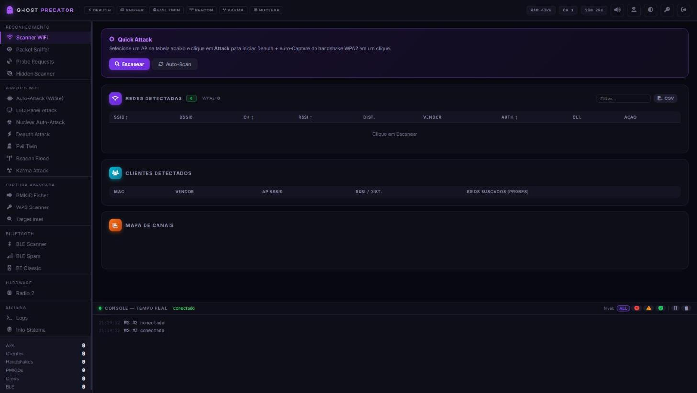
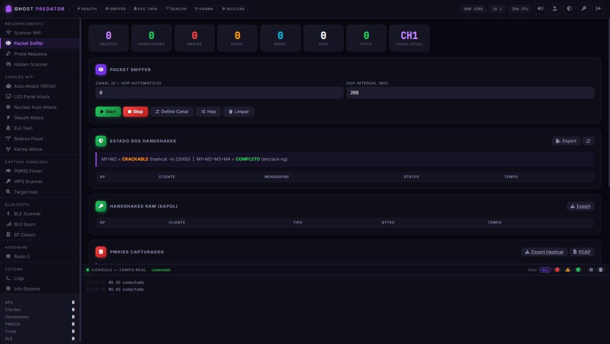
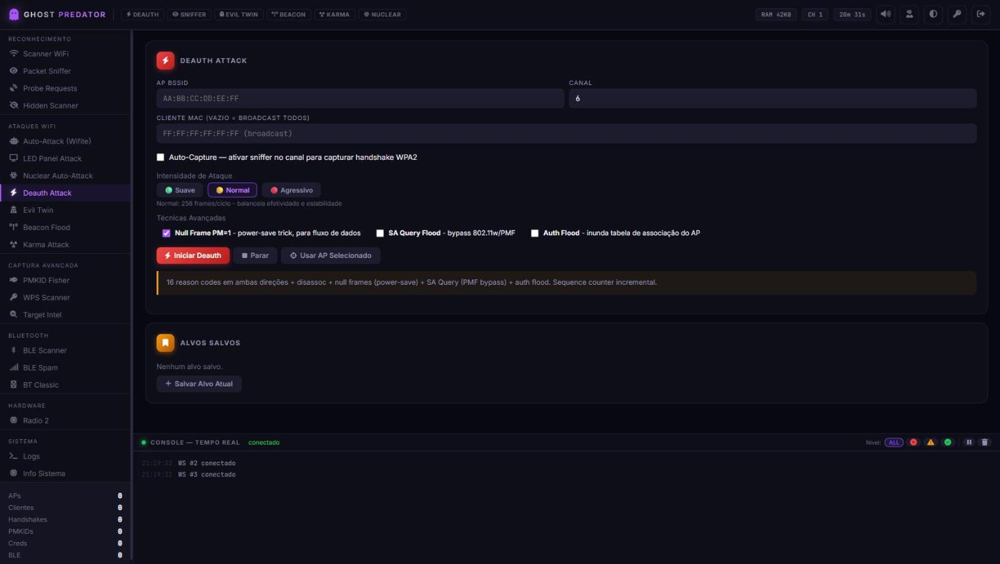
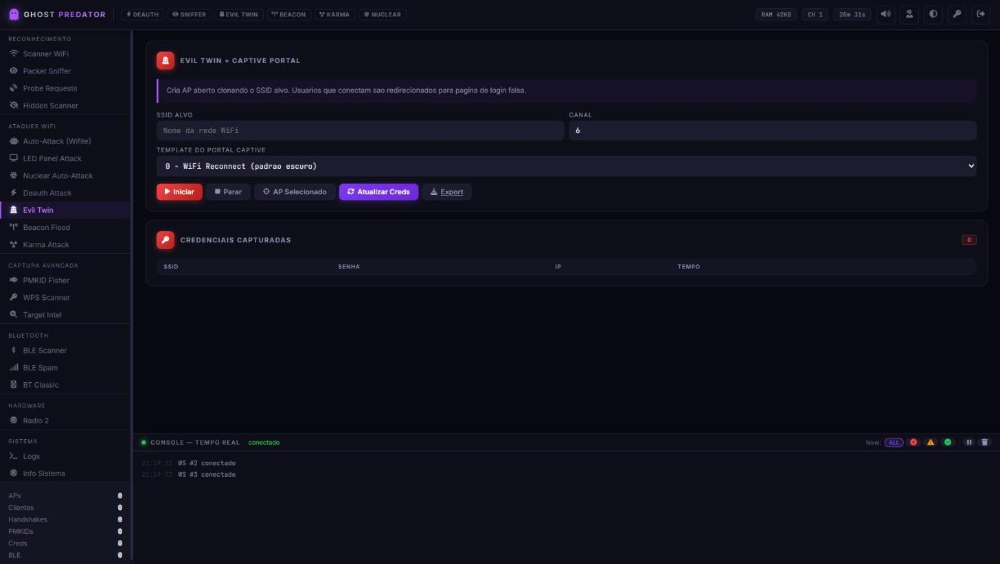
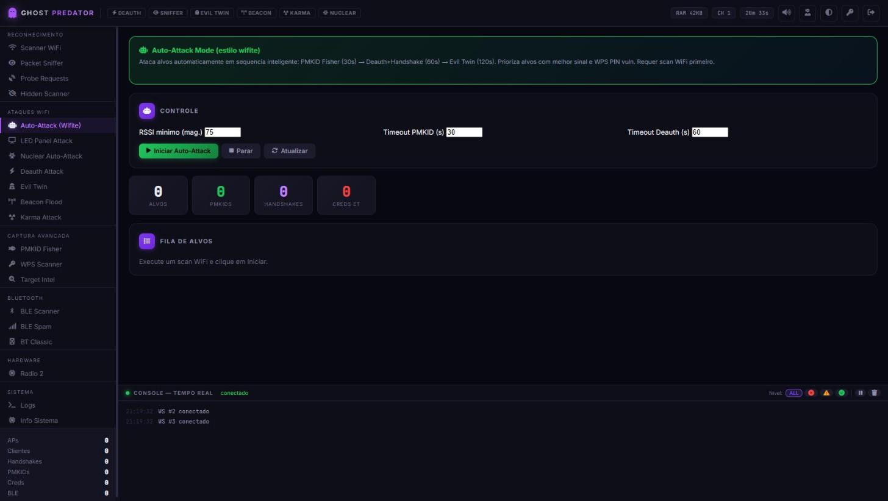
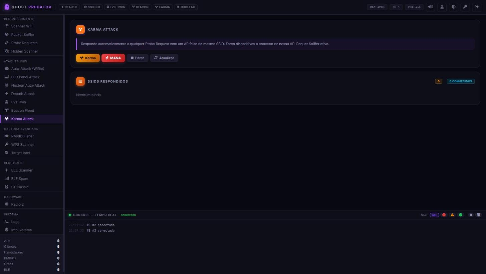
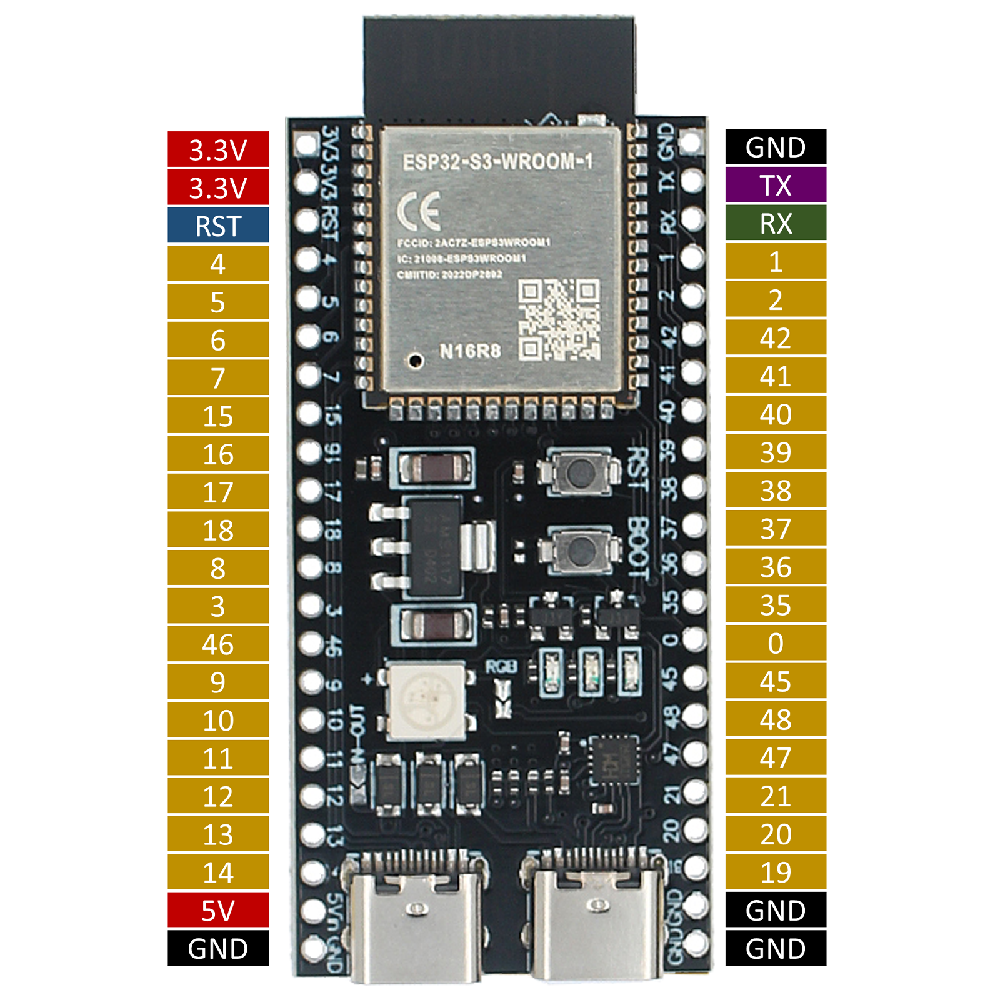
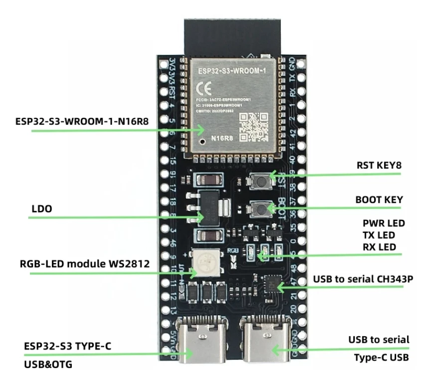
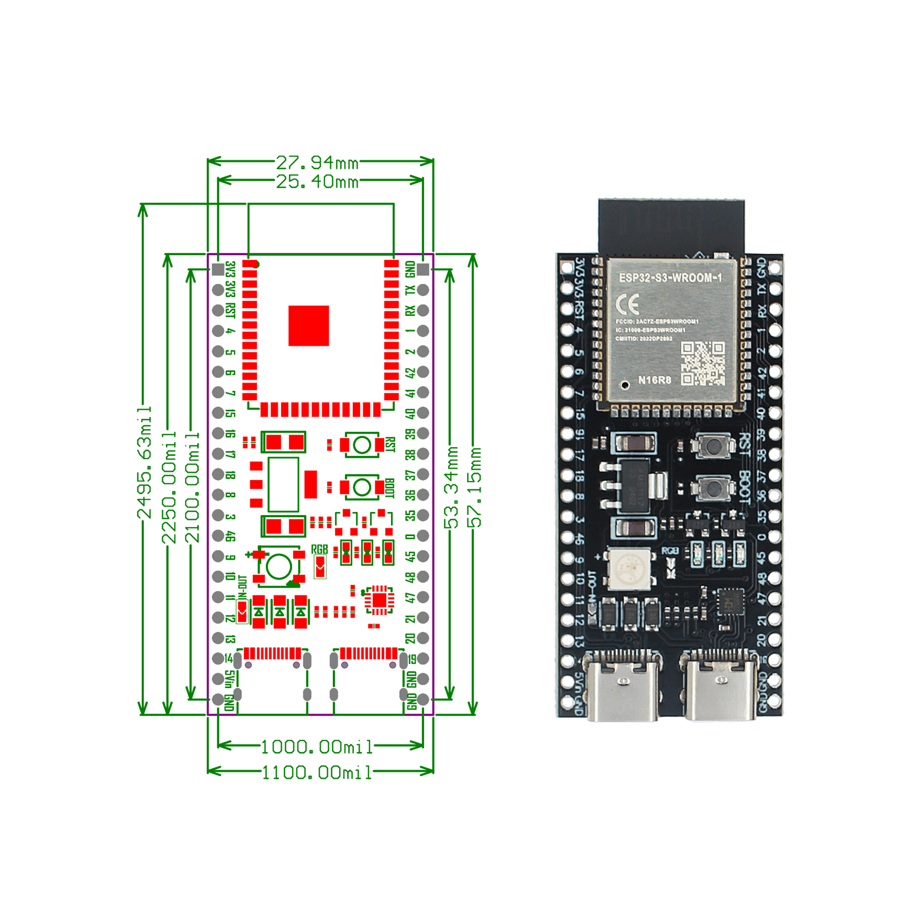

# Ghost Predator Mobile - ESP32

> Plataforma portátil de avaliação de segurança WiFi e Bluetooth, rodando diretamente no ESP32 com interface web SPA acessível pelo celular ou notebook. Sem software adicional, sem sistema operacional especial - basta conectar e usar.

**Versão atual: v4.6** | [Instalação](#instalação) | [Como Usar](#como-usar) | [Ataques](#módulos-de-ataque) | [Arquitetura](#arquitetura-técnica)

---

## Screenshots

| Scanner WiFi | Packet Sniffer |
|---|---|
|  |  |

| Deauth Attack | Evil Twin + Captive Portal |
|---|---|
|  |  |

| Auto-Attack (Wifite) | Karma Attack |
|---|---|
|  |  |

---

## Índice

1. [O que é o Ghost Predator Mobile](#o-que-é-o-ghost-predator-mobile)
2. [Como Funciona](#como-funciona)
3. [Hardware Suportado](#hardware-suportado)
4. [Instalação](#instalação)
5. [Como Usar](#como-usar)
6. [Interface Web](#interface-web)
7. [Módulos de Reconhecimento](#módulos-de-reconhecimento)
8. [Módulos de Ataque](#módulos-de-ataque)
9. [Captura Avançada](#captura-avançada)
10. [Bluetooth](#bluetooth)
11. [Atalhos de Teclado](#atalhos-de-teclado)
12. [Arquitetura Técnica](#arquitetura-técnica)
13. [Aviso Legal](#aviso-legal)

---

## O que é o Ghost Predator Mobile

O Ghost Predator Mobile transforma um microcontrolador ESP32 em uma ferramenta completa de auditoria de segurança sem fio. O dispositivo funciona como um **Access Point autônomo**: ao ligar, ele cria sua própria rede WiFi (`GhostPredator`) e hospeda uma aplicação web completa acessível em `192.168.4.1`.

### Por que ESP32?

O ESP32 possui dois núcleos de processamento de 240 MHz, rádio WiFi 802.11 b/g/n e Bluetooth Classic + BLE integrados. O chip suporta **modo promíscuo** (capturar todos os pacotes no ar), **injeção de frames raw 802.11** (enviar pacotes falsificados), e pode operar em múltiplos modos simultaneamente (AP + Station + Promíscuo).

### Casos de Uso

- Auditoria de segurança em redes próprias ou com autorização
- Verificar vulnerabilidades antes que atacantes reais as explorem
- Testes de penetração wireless (pentest WiFi)
- Educação e pesquisa em segurança de redes
- Captura de handshakes WPA2 para análise de força de senha
- Detecção de redes vulneráveis (WPS ativo, redes abertas, PMF desabilitado)

---

## Como Funciona

```
                    [ESP32]
                   /       \
    Rádio WiFi              Rádio WiFi
    (AP Mode)               (Station/Monitor Mode)
         |                        |
   GhostPredator              Modo Promíscuo
   192.168.4.1                (captura pacotes)
         |                        |
   [Navegador do              [Pacotes 802.11]
    usuário]                  EAPOL, Beacons,
         |                    Probes, Data...
   Interface Web
   (SPA em LittleFS)
```

O ESP32 opera em dois modos de rádio simultaneamente:
1. **AP (Access Point)**: cria a rede `GhostPredator` para o usuário se conectar e acessar o painel
2. **Monitor/Promíscuo**: usa o mesmo rádio para capturar ou injetar pacotes nas redes-alvo

A interface web é uma **Single Page Application (SPA)** armazenada no sistema de arquivos LittleFS do ESP32. Não há dependências externas - todo o HTML, CSS e JavaScript são servidos pelo próprio dispositivo.

A comunicação entre o navegador e o ESP32 usa:
- **HTTP REST** (`/api/*`): para comandos e consultas
- **WebSocket** (`/ws`): para log em tempo real e atualizações contínuas

---

## Hardware Suportado

| Chip | Board | Flash | RAM | Observações |
|------|-------|-------|-----|-------------|
| **ESP32-D0WD-V3** | DevKit v1 / WROOM-32 | 4MB | 520KB SRAM | Testado e validado, hardware base |
| **ESP32-S3 N16R8** | WROOM-1 N16R8 44Pin | **16MB** | **8MB PSRAM** | **Hardware recomendado** - superior em tudo |
| **ESP32-S3** | DevKitC-1 | 4MB | 512KB SRAM | Suportado - USB OTG nativo |
| **ESP32-C3** | DevKitM-1 | 4MB | 400KB SRAM | Suportado - RISC-V, sem BT Classic |

### ESP32-S3 N16R8 - Hardware Recomendado

O **ESP32-S3 WROOM-1 N16R8** (disponivel na Shopee por R$13-27) e o hardware ideal para o Ghost Predator Mobile:

| | ESP32 D0WD-V3 (base) | ESP32-S3 N16R8 (recomendado) |
|---|---|---|
| **CPU** | Xtensa LX6 Dual Core 240MHz | **Xtensa LX7 Dual Core 240MHz** |
| **Flash** | 4MB | **16MB** (4x mais) |
| **SRAM** | 520KB | **512KB + 16KB RTC SRAM** |
| **PSRAM** | - | **8MB OPI PSRAM** |
| **RAM Total** | 520KB | **~8.5MB efetivo** |
| **GPIOs** | 34 | **45 GPIOs** |
| **ADC** | 2x 12-bit | **2x 12-bit (ate 20 canais)** |
| **USB** | Via CH340 (UART) | **USB OTG nativo** + CH343P serial |
| **I2C** | 2x | 2x |
| **SPI** | 4x | 4x |
| **I2S** | 2x | 2x |
| **RGB LED** | - | **WS2812 integrado** |
| **BLE** | 4.2 | **5.0** (maior alcance BLE Spam) |
| **Seguranca** | AES, SHA | **AES, SHA, RSA, ECC, RNG + Secure Boot** |
| **Temperatura** | -40 a 85°C | -40 a 65°C |
| **Particoes** | huge_app.csv (3MB app) | **partitions_16mb.csv (5MB app + 6MB LittleFS)** |

**Por que 16MB + 8MB PSRAM muda tudo:**
- Interface web pode ter mais features sem comprimir
- Buffer de captura de pacotes muito maior em RAM (8MB vs 520KB)
- Logs de captura maiores armazenados diretamente no dispositivo
- Possibilidade de armazenar wordlists pequenas no LittleFS (6MB disponivel)
- CPU LX7 e ~37% mais rapida que LX6 por clock cycle
- Secure Boot e Flash Encryption nativos para proteger o firmware

**Componentes da placa:**

```
[ESP32-S3 N16R8 - 44 pinos, 57.15mm x 27.94mm]

  Lado esquerdo:              Lado direito:
  3.3V, 3.3V, RST             GND, TX, RX
  GPIO 4,5,6,7,15,16          GPIO 1,2,42,41,40,39
  GPIO 17,18,8,3,46           GPIO 38,37,36,35,0
  GPIO 9,10,11,12,13,14       GPIO 45,48,47,21,20,19
  5V                          GND, GND

  Modulo: ESP32-S3-WROOM-1-N16R8
  RGB LED: WS2812 (GPIO 48)
  USB OTG: USB-C esquerda (native USB)
  USB Serial: USB-C direita (CH343P)
  Botoes: RST (GPIO 38), BOOT (GPIO 0)
  LEDs: PWR, TX, RX
```



| Componentes | Dimensoes |
|---|---|
|  |  |

### Flashando no ESP32-S3 N16R8

```bash
# Upload firmware para N16R8 (usa partitions_16mb.csv automaticamente)
pio run --target upload -e esp32-s3-n16r8

# Upload filesystem LittleFS
pio run --target uploadfs -e esp32-s3-n16r8
```

**Porta USB:** Use sempre a porta **USB OTG (esquerda)** para programar o N16R8, ou a **USB Serial (direita)** com CH343P - ambas funcionam.

**Modo bootloader manual** (se necessario):
1. Segure o botao **BOOT**
2. Pressione **RST** rapidamente
3. Solte **BOOT**
4. Execute o upload

### Requisitos de Hardware

- **RAM**: minimo 4MB Flash (recomendado 16MB para N16R8)
- **Antena**: antena externa recomendada para maior alcance de captura

### Alimentacao

O ESP32 pode ser alimentado via:
- USB-C (5V do cabo - ideal para uso com celular via OTG)
- Bateria LiPo 3.7V com regulador de tensao
- Power bank USB (uso portatil)

---

## Modulos WiFi Externos

O Ghost Predator Mobile usa o radio WiFi integrado do ESP32. Para cenarios avancados, e possivel adicionar modulos WiFi externos.

### Via USB OTG (ESP32-S3)

O ESP32-S3 possui USB OTG nativo, permitindo conectar adaptadores WiFi USB:

```
[ESP32-S3] <--USB OTG--> [Adaptador WiFi USB]
                              (RT8720, RTL8188)
```

**Hardware necessario:**
- Adaptador USB WiFi com chipset suportado por Linux (RT8720DN, RTL8188EUS)
- Cabo OTG USB-C para USB-A
- Biblioteca USB Host para ESP32-S3

**Limitacoes:** O ESP32 nao roda Linux, entao o driver do adaptador WiFi precisa ser portado para bare-metal. Projeto complexo, recomendado apenas para desenvolvedores avancados.

**Alternativa pratica:** Use o radio WiFi interno para captura e um segundo ESP32 como repeater/bridge.

### Via GPIO/SPI - Modulo ESP8266

A forma mais simples de ter um segundo radio WiFi e conectar um **ESP8266** via UART:

```
[ESP32]                    [ESP8266]
GPIO17 (TX) -----------> RX
GPIO16 (RX) <----------- TX
GND -------------------- GND
3.3V ------------------- VCC (max 500mA)
```

**Configuracao no ESP8266:**
- Flash com firmware AT (Espressif AT firmware)
- ESP32 controla o ESP8266 via comandos AT pela UART

**Casos de uso:**
- ESP32 faz o AP principal + captura
- ESP8266 faz deauth em um canal diferente simultaneamente
- Aumenta cobertura geografica dos ataques

### Via SPI - Modulo W5500 (Ethernet)

Para conectar o dispositivo a uma rede cabeada:

```
[ESP32]       [W5500]
GPIO18 ------> SCK
GPIO23 ------> MOSI
GPIO19 <------ MISO
GPIO5  ------> CS
3.3V  ------> VCC
GND   ------> GND
```

### Via UART - Modulo SIM800L (4G/LTE)

Para acesso remoto via rede celular:

```
[ESP32]               [SIM800L / SIM7600]
GPIO17 (TX) --------> RX
GPIO16 (RX) <-------- TX
GND ----------------> GND
4V (externo) -------> VCC (4.0V, NÃO 3.3V!)
```

**Uso:** O modulo 4G permite acesso remoto ao painel do Ghost Predator via internet, sem precisar de WiFi local.

---

## Expandindo a Memoria do ESP32

### Trocar para ESP32-S3 N16R8 (mais simples)

A forma mais facil de ter mais memoria e simplesmente usar o **ESP32-S3 N16R8** em vez do ESP32 original. Sem soldagem, sem risco, com 4x mais Flash e 16x mais RAM efetiva.

### PSRAM Externa via SPI (ESP32 original)

O ESP32-D0WD suporta PSRAM externa via SPI. Alguns modulos WROVER ja vem com 4MB de PSRAM soldada:

- **ESP32-WROVER-B**: 4MB PSRAM (SPIRAM)
- **ESP32-WROVER-E**: 4MB PSRAM + antena externa

Para habilitar no `platformio.ini`:
```ini
build_flags =
    -DBOARD_HAS_PSRAM=1
    -mfix-esp32-psram-cache-issue
```

No codigo:
```cpp
#include "esp_heap_caps.h"

// Alocar no PSRAM
void* buf = heap_caps_malloc(1024*1024, MALLOC_CAP_SPIRAM);

// Verificar PSRAM disponivel
size_t psram = heap_caps_get_free_size(MALLOC_CAP_SPIRAM);
Serial.printf("PSRAM livre: %d bytes\n", psram);
```

### Flash Externa Adicional (avancado)

E possivel conectar chips Flash SPI extras ao ESP32 para armazenamento adicional de dados (nao de codigo):

```
[ESP32]       [W25Q128 - 16MB Flash SPI]
GPIO18 ------> CLK
GPIO23 ------> MOSI (DI)
GPIO19 <------ MISO (DO)
GPIO22 ------> CS
3.3V  ------> VCC
GND   ------> GND
```

Use a biblioteca `SPIFlash` para ler/gravar:
```cpp
#include <SPIFlash.h>

SPIFlash flash(22); // CS pin

void setup() {
    flash.begin();
    flash.writeStr(0, "Ghost Predator Data");
}
```

**Casos de uso:**
- Armazenar handshakes capturados (sem limite do LittleFS principal)
- Wordlists para ataque offline
- Logs de longa duracao

### Resumo de Capacidades por Hardware

| Hardware | Flash Total | RAM Total | Custo Aprox. | Recomendado Para |
|---|---|---|---|---|
| ESP32 D0WD-V3 | 4MB | 520KB | R$10-20 | Inicio rapido, testes |
| ESP32-WROVER-B | 4MB | 4.5MB | R$20-35 | Mais RAM sem trocar placa |
| ESP32-S3 N16R8 | **16MB** | **8.5MB** | R$13-27 | **Uso sério, producao** |
| ESP32-S3 + Flash ext. | 16MB + 16MB | 8.5MB | R$30-50 | Armazenamento massivo |

---

## Instalação

Este guia cobre tudo desde o zero — do download do software ate o dispositivo funcionando.

### Passo 1 — Instalar o Python e PlatformIO

O PlatformIO e o sistema de build que compila e envia o firmware para o ESP32.

**Windows:**
```powershell
# Instalar Python (se nao tiver)
winget install Python.Python.3

# Instalar PlatformIO via pip
pip install platformio

# Verificar instalacao
pio --version
```

**Linux/macOS:**
```bash
pip3 install platformio
pio --version
```

> **Alternativa:** instalar a extensao [PlatformIO IDE](https://platformio.org/install/ide?install=vscode) no VS Code — interface grafica completa.

### Passo 2 — Clonar o Repositório

```bash
git clone https://github.com/Ghost-Bx1/Ghost-Raptor-Mobile-ESP32.git
cd Ghost-Raptor-Mobile-ESP32
```

**Estrutura do projeto:**
```
Ghost-Raptor-Mobile-ESP32/
├── src/
│   ├── main.cpp              # Loop principal, setup WiFi/BLE
│   ├── config.h              # Senhas, limites, pinos
│   ├── wifi/
│   │   ├── scanner.h         # Scanner WiFi
│   │   ├── deauth.h          # Deauth + assocFlood + reconnectBlock
│   │   ├── evil_twin.h       # Evil Twin + captive portal
│   │   ├── sniffer.h         # Captura EAPOL/handshakes/PMKIDs
│   │   ├── pmkid_fisher.h    # PMKID sem clientes (Auth+Assoc inject)
│   │   ├── karma.h           # Karma + MANA attack
│   │   ├── beacon_flood.h    # Beacon flood + channel hop + hidden
│   │   ├── wifite_mode.h     # Auto-attack orquestrador
│   │   └── wps_scanner.h     # Deteccao WPS PIN/Pixie Dust
│   ├── bluetooth/            # BLE Spam (Apple/Samsung/Windows)
│   └── web/server.h          # ESPAsyncWebServer + REST + WebSocket
├── data/
│   └── index.html            # SPA completa (~3000 linhas)
├── platformio.ini            # Configuracao de build por placa
└── partitions_16mb.csv       # Tabela de particoes para N16R8
```

### Passo 3 — Conectar o ESP32

**ESP32 D0WD-V3 (padrao):**
- Conecte via cabo USB ao computador
- Verifique a porta: Windows = `COM3` (geralmente), Linux = `/dev/ttyUSB0`

**ESP32-S3 N16R8:**
- Use a porta **USB-C da direita** (CH343P serial) para programar
- Ou a porta **USB-C da esquerda** (USB OTG nativo) — ambas funcionam
- Windows instala driver automaticamente (CH343P)
- Linux: `ls /dev/ttyACM*` ou `/dev/ttyUSB*`

**Verificar porta no Windows:**
```powershell
# Abre gerenciador de dispositivos na secao "Portas COM e LPT"
devmgmt.msc
```

**Se o ESP32 nao aparecer:**
- ESP32 padrao: instalar driver [CH340](https://www.wch-ic.com/downloads/CH341SER_EXE.html)
- ESP32-S3 N16R8: instalar driver [CH343P](https://www.wch-ic.com/downloads/CH343SER_EXE.html)

### Passo 4 — Upload do Firmware

O firmware e o codigo C++ que controla o hardware.

```bash
# ESP32 padrao (WROOM-32, DevKit v1)
pio run --target upload -e esp32dev

# ESP32-S3 N16R8 — 16MB Flash + 8MB PSRAM (RECOMENDADO)
pio run --target upload -e esp32-s3-n16r8

# ESP32-S3 generico (4MB Flash)
pio run --target upload -e esp32-s3

# ESP32-C3
pio run --target upload -e esp32-c3
```

**Especificar porta manualmente (se o PlatformIO nao detectar):**
```bash
pio run --target upload -e esp32dev --upload-port COM3
# Linux:
pio run --target upload -e esp32dev --upload-port /dev/ttyUSB0
```

**Saida esperada de sucesso:**
```
Uploading .pio/build/esp32dev/firmware.bin
...
Hash of data verified.
========================= [SUCCESS] Took XX seconds =========================
```

**Se der erro de permissao (Linux):**
```bash
sudo usermod -a -G dialout $USER
# Fazer logout e login novamente
```

**Modo bootloader manual** (se o upload falhar):
1. Segure o botao **BOOT** no ESP32
2. Pressione e solte o botao **RST** rapidamente
3. Solte o **BOOT**
4. Execute o comando de upload novamente

### Passo 5 — Upload do Filesystem (Interface Web)

O filesystem LittleFS contem o arquivo `data/index.html` com toda a interface web. **Este passo e obrigatório** — sem ele, o painel nao aparece.

```bash
# ESP32 padrao
pio run --target uploadfs -e esp32dev

# ESP32-S3 N16R8 (6MB LittleFS disponivel)
pio run --target uploadfs -e esp32-s3-n16r8

# ESP32-S3 generico
pio run --target uploadfs -e esp32-s3
```

> **Importante:** Firmware e Filesystem sao uploads separados. Se modificar o `data/index.html`, precisa rodar `uploadfs` novamente. Se modificar codigo C++ em `src/`, precisa rodar `upload` novamente.

**Saida esperada:**
```
Building FS image from 'data' directory to .pio/build/.../littlefs.bin
/index.html
...
Hash of data verified.
========================= [SUCCESS] Took XX seconds =========================
```

### Passo 6 — Primeiro Acesso

Apos o upload completar, o ESP32 reinicia automaticamente:

1. **Aguarde ~3 segundos** para o ESP32 inicializar
2. No celular ou notebook, abra as **configuracoes de WiFi**
3. Conecte na rede: **`GhostPredator`**
4. Senha WiFi: **`predator123`**
5. Abra o navegador e acesse: **`http://192.168.4.1`**
6. Digite a senha do painel: **`predator`**

> **Dica:** Acesse tambem por **`http://ghostpredator.local`** (mDNS) em vez de digitar o IP.

### Solucao de Problemas Comuns

| Problema | Causa | Solucao |
|---|---|---|
| Upload falha com "No serial data received" | ESP32 nao entrou em bootloader | Segurar BOOT + pressionar RST |
| Porta COM nao aparece | Driver nao instalado | Instalar CH340 (ESP32) ou CH343P (S3) |
| Painel web em branco / 404 | Filesystem nao foi uploaded | Rodar `uploadfs` |
| "A porta COM3 nao existe" | Porta mudou ou desconectado | Verificar no Gerenciador de Dispositivos |
| Upload OK mas WiFi GhostPredator nao aparece | Firmware com erro | Ver Serial Monitor: `pio device monitor` |
| Pagina carrega mas sem dados | Cookie de sessao expirou | Fazer login novamente |

**Ver logs em tempo real:**
```bash
pio device monitor --port COM3 --baud 115200
# ou
pio device monitor -e esp32dev
```

---

## Como Usar

### Fluxo Básico de Uso

```
1. Conectar ao WiFi GhostPredator
         |
2. Acessar http://192.168.4.1
         |
3. Fazer login (senha: predator)
         |
4. Executar Scanner WiFi
         |
5. Selecionar rede-alvo na tabela
         |
6. Escolher o ataque desejado
         |
7. Monitorar resultados no painel
```

### Auto-Login

A partir da v4.2, o painel salva um token de sessão no `localStorage` do navegador por **30 minutos**. Ao revisitar `192.168.4.1` dentro desse prazo, o login é feito automaticamente sem precisar digitar a senha novamente.

### Selecionar um Alvo

1. Vá em **Scanner WiFi** e clique em **Escanear**
2. Na tabela de resultados, clique no botão **Attack** ao lado de uma rede
3. O alvo fica salvo (SSID, BSSID, canal) e é pré-preenchido em todos os módulos de ataque
4. A linha do alvo fica destacada em vermelho na tabela
5. O "Quick Attack" no topo do scanner ativa Deauth + captura de handshake com 1 clique

### Alternar Tema

Clique no ícone de lua/sol na barra superior para alternar entre tema escuro e claro.

### Alterar Senha do Painel

Clique no ícone de cadeado/chave na barra superior e siga as instruções.

---

## Interface Web

### Topbar (Barra Superior)

A barra superior exibe:

| Elemento | Descrição |
|----------|-----------|
| **Badges de ataque** | DEAUTH / SNIFFER / EVIL TWIN / BEACON / KARMA / NUCLEAR - pulsam quando ativos |
| **RAM** | Memória heap livre no ESP32 em tempo real |
| **CH** | Canal WiFi atual do sniffer |
| **Uptime** | Tempo de funcionamento do dispositivo |
| **Som** | Liga/desliga alertas sonoros do painel |
| **Stealth** | Modo furtivo - reduz transmissões visíveis |
| **Tema** | Alterna claro/escuro |
| **Senha** | Altera senha de acesso |
| **Logout** | Encerra sessão |

### Sidebar (Menu Lateral)

Organizada em categorias:
- **Reconhecimento**: Scanner WiFi, Packet Sniffer, Probe Requests, Hidden Scanner
- **Ataques WiFi**: Auto-Attack, LED Panel, Nuclear, Deauth, Evil Twin, Beacon Flood, Karma
- **Captura Avançada**: PMKID Fisher, WPS Scanner, Target Intel
- **Bluetooth**: BLE Scanner, BLE Spam, BT Classic
- **Hardware**: Radio 2
- **Sistema**: Logs, Info Sistema

Os contadores ao lado dos itens do menu atualizam em tempo real (ex: número de handshakes, credenciais capturadas).

### Console / Logs em Tempo Real

Na parte inferior da tela fica o console de logs via WebSocket. Cada mensagem tem nível de severidade com cor:
- **Cinza**: informação
- **Amarelo**: aviso
- **Vermelho**: erro
- **Verde**: sucesso/captura
- **Ciano**: dado importante

O ponto verde/vermelho ao lado do título indica o status da conexão WebSocket. Se cair, o painel reconecta automaticamente.

### Barra de Status de Ataque Ativo

Quando o Deauth está ativo, uma barra laranja aparece no topo mostrando:
- Número de frames injetados
- Taxa de frames por segundo (f/s)
- Tempo decorrido do ataque

---

## Módulos de Reconhecimento

### Scanner WiFi

O scanner realiza uma varredura 802.11 passiva de todas as redes próximas.

**Como funciona:**
1. O ESP32 envia probe requests broadcast em todos os canais (1-13)
2. Os APs respondem com beacon frames contendo: SSID, BSSID, canal, RSSI, segurança, suporte WPS
3. O firmware analisa os frames e popula a tabela

**Dados coletados por rede:**

| Campo | Descrição |
|-------|-----------|
| **SSID** | Nome da rede (vazio = rede oculta) |
| **BSSID** | Endereço MAC do AP |
| **Canal** | 1-13 (frequência de operação) |
| **RSSI** | Potência do sinal em dBm (-45 = forte, -85 = fraco) |
| **Distância** | Estimada pelo modelo Log-Distance Path Loss (n=2.7 para indoor) |
| **Vendor** | Fabricante do AP via tabela OUI (~70 vendors) |
| **Auth** | Segurança (Open, WEP, WPA, WPA2, WPA3, WPS) |
| **Clientes** | Dispositivos associados detectados pelo sniffer |

**Barras de sinal:**
A qualidade do sinal é exibida como barras segmentadas (5 barras). Verde = bom sinal, amarelo = sinal médio, vermelho = sinal fraco.

**Mapa de Canais:**
Visualização gráfica da distribuição de redes por canal (1-13). Canais com muitas redes aparecem em vermelho (saturados). Clique em uma barra de canal para filtrar a tabela mostrando apenas as redes naquele canal. Clique novamente para remover o filtro.

**Exportar CSV:**
O botão CSV exporta a tabela completa em formato CSV para análise em planilhas.

**Auto-Scan:**
Liga o escaneamento automático contínuo (novo scan a cada 30 segundos).

**Ordenação:**
Clique nos cabeçalhos de coluna (SSID, Canal, RSSI, Auth) para ordenar a tabela.

---

### Packet Sniffer

O sniffer coloca o rádio WiFi em **modo promíscuo**: todos os pacotes 802.11 no ar são capturados, incluindo de redes às quais não estamos associados.

**Como funciona:**
1. `esp_wifi_set_promiscuous(true)` ativa o modo promíscuo
2. `esp_wifi_set_promiscuous_rx_cb()` registra callback para cada pacote recebido
3. O firmware analisa o header 802.11 de cada frame e categoriza por tipo

**Tipos de frames capturados:**

| Tipo | Descrição |
|------|-----------|
| **Management** | Beacons, probe requests/responses, auth, assoc, deauth, disassoc |
| **Data** | Frames de dados de usuários associados a APs |
| **EAPOL** | Protocolo de autenticação WPA2 - 4-way handshake |
| **PMKID** | Identificador de chave de sessão - captura sem handshake completo |

**Channel Hopping:**
Com canal definido como `0`, o sniffer salta automaticamente entre canais a cada `hop_interval` ms (padrão: 200ms). Isso maximiza a cobertura mas reduz o tempo em cada canal.

**O Handshake WPA2 explicado:**

O handshake WPA2 é composto por 4 mensagens EAPOL (IEEE 802.1X):
```
Cliente                          AP (Access Point)
   |                                   |
   |<------- M1: ANonce (AP nonce) ----|
   |--- M2: SNonce + MIC (PTK) ------->|  <- MAIS IMPORTANTE (crackavel)
   |<------- M3: GTK encriptado -------|
   |--- M4: Confirmação -------------->|
```

- **M1+M2** (estado `CRACKABLE`): suficiente para cracking com hashcat formato 22000
- **M1+M2+M3+M4** (estado `COMPLETO`): handshake completo, compatível com aircrack-ng

**Como usar o handshake para cracking:**
```bash
# Exportar do painel: botão "Export Hashcat"
hashcat -m 22000 handshakes.txt wordlist.txt --force
# ou
aircrack-ng -w wordlist.txt capture.pcap
```

O painel mostra o estado de cada par AP+Cliente detectado (mensagens capturadas).

**Exportar:**
- **PCAP**: captura em formato Wireshark/tcpdump para análise offline
- **Hashcat**: hashes em formato compatível com hashcat para cracking

---

### Probe Requests

Dispositivos WiFi buscam continuamente redes conhecidas enviando **probe requests** com os SSIDs das redes salvas no histórico do dispositivo.

**O que revelam:**
- Lista de redes WiFi que o dispositivo frequentou no passado
- MAC address do dispositivo (permite rastreamento)
- Presença do dispositivo no ambiente
- Padrões de comportamento (onde o usuário vai regularmente)

O painel coleta e exibe: MAC de origem, vendor, lista de SSIDs buscados, RSSI e distância estimada.

---

### Hidden Scanner

Redes "ocultas" (hidden SSID) não transmitem beacon com o nome da rede, mas ainda respondem a **probe requests dirigidos** com o SSID correto.

**Técnica de revelação:**
1. O firmware coleta BSSIDs de APs com SSID vazio durante o scan
2. Para cada BSSID, envia probe requests com SSID nulo (directed probe)
3. Se o AP responder com o SSID real, ele foi revelado

**Limitação**: se o AP não estiver configurado para responder a directed probes, o SSID permanece desconhecido. Em redes modernas com 802.11w/PMF, alguns APs ignoram esses probes.

> **Mito desmontado**: ocultar o SSID NÃO é uma medida de segurança eficaz. Qualquer ferramenta básica revela SSIDs ocultos ao capturar probe requests de clientes associados ou directed probes.

---

### Target Intel

Fingerprinting detalhado de dispositivos associados a uma rede monitorada em modo promíscuo.

**Dados coletados:**
- MAC address e vendor do dispositivo
- Consultas DNS realizadas (pacotes UDP porta 53 não-criptografados)
- Credenciais HTTP capturadas em tráfego não-criptografado (HTTP básico)
- User-Agents HTTP (sistema operacional, navegador do dispositivo)
- Horários de atividade e padrões

---

## Módulos de Ataque

> **AVISO**: Use apenas em redes próprias ou com autorização expressa e documentada do responsável pela rede. Uso não autorizado é crime.

Esta seção explica cada ataque de forma completa: o que é, como funciona na prática (em linguagem simples), e os detalhes técnicos para quem quiser entender mais fundo.

---

### Deauth Attack (Ataque de Desautenticacao)

#### O que e?

O Deauth Attack desconecta forcadamente qualquer dispositivo (celular, notebook, smart TV, etc.) de uma rede WiFi. E como se alguem fingisse ser o roteador e mandasse uma mensagem dizendo "voce esta desconectado" - e o celular obedece sem questionar.

#### Por que funciona?

O protocolo WiFi (IEEE 802.11) foi projetado nos anos 90 sem autenticacao nos pacotes de gerenciamento. Isso significa que qualquer pessoa no mesmo canal pode enviar um pacote se passando pelo roteador, e o dispositivo-alvo vai acreditar e se desconectar. Essa falha existe em praticamente todos os roteadores e dispositivos WiFi que nao tem PMF (Protected Management Frames) ativo.

> **Analogia**: Imagine que qualquer pessoa pode ligar para o seu celular fingindo ser o banco e dizer "sua conta foi encerrada, desligue agora". Se voce acreditar sem verificar, e exatamente o que acontece com os dispositivos WiFi.

#### Como funciona na pratica, passo a passo:

```
1. O Ghost Predator entra em modo monitor (escuta todo o trafego WiFi)
2. Voce seleciona a rede-alvo e o dispositivo que quer desconectar
3. O ESP32 fabrica um pacote falso de "deautenticacao":
   - Campo "De:" = MAC do roteador (falsificado)
   - Campo "Para:" = MAC do celular (ou FF:FF:FF:FF:FF:FF para todos)
   - Campo "Motivo:" = Codigo de razao (ex: "AP esta sendo desligado")
4. O pacote e injetado no ar via esp_wifi_80211_tx()
5. O celular recebe o pacote, acha que e do roteador, e desconecta
6. O celular automaticamente tenta se reconectar
7. Durante a reconexao, o sniffer do Ghost Predator captura o handshake WPA2
```

#### Tecnicas implementadas:

| Tecnica | O que faz |
|---------|-----------|
| **Deauth AP->Cliente** | Finge ser o roteador e manda o cliente embora |
| **Deauth Cliente->AP** | Finge ser o cliente e manda uma mensagem de "saida" ao roteador |
| **Disassociacao** | Variante mais agressiva do deauth (nivel de protocolo diferente) |
| **16 Reason Codes** | Rotaciona entre os 16 codigos de motivo do protocolo para dificultar deteccao |
| **Null Data Frame (PM=1)** | Truque de power-save: faz o roteador guardar pacotes em buffer e para de entregar ao cliente |
| **SA Query Flood** | Tecnica para tentar bypassar a protecao PMF em roteadores mais modernos |
| **Auth Flood** | Enche a tabela de conexoes do roteador com MACs falsos (pode causar lentidao no AP) |

#### Modos de intensidade:

| Modo | Pacotes por ciclo | Quando usar |
|------|-------------------|-------------|
| Suave | 64 | Teste inicial, menos interferencia no ambiente |
| Normal | 256 | Uso geral na maioria dos cenarios |
| Agressivo | 512 | Maximo impacto, tentar bypassar PMF basico |

#### O que voce configura no painel:
- **Rede-alvo**: selecione do scan - o BSSID (MAC do roteador) e canal sao preenchidos automaticamente
- **Cliente especifico**: selecione um dispositivo especifico para desconectar, ou deixe em broadcast (FF:FF:FF:FF:FF:FF) para expulsar todos ao mesmo tempo
- **Modo**: suave / normal / agressivo

#### Protecao contra este ataque (PMF / 802.11w):
Roteadores modernos com **PMF (Protected Management Frames)** habilitado assinam criptograficamente os pacotes de gerenciamento, tornando os deauths falsificados ineficazes para clientes especificos. O Ghost Predator tenta contornar isso com **SA Query Flood**: inunda o roteador com requisicoes que alguns firmwares nao conseguem processar rapido o suficiente.

#### O que aparece no painel:
- Total de pacotes enviados
- Taxa de envio (pacotes por segundo)
- Timer ao vivo do ataque

---

### Evil Twin (Rede Falsa + Portal Captive)

#### O que e?

O Evil Twin cria uma copia identica de uma rede WiFi real - mesmo nome, mesmo tipo de seguranca (mas sem senha). O objetivo e fazer as pessoas se conectarem sem perceber e, ao tentar acessar a internet, verem uma pagina falsa pedindo a senha do WiFi.

#### Por que funciona?

Quando voce esta desconectado do seu WiFi e varias redes com o mesmo nome aparecem, seu celular ou notebook tende a se conectar ao sinal mais forte. O Ghost Predator cria um AP com o mesmo nome da rede real porem sem senha (aberto), e simultaneamente usa o Deauth Attack para derrubar o sinal da rede real. Com o sinal real fraco ou indisponivel, o dispositivo conecta no Evil Twin.

> **Analogia**: E como abrir uma loja falsa com o mesmo nome e aparencia de uma loja famosa ao lado, fechar a original temporariamente, e quando o cliente entrar na sua, pedir para ele "confirmar o cartao" para entrar.

#### Fluxo completo do ataque, etapa por etapa:

```
Etapa 1 - Reconhecimento:
  O Ghost Predator escaneia e identifica a rede-alvo (SSID, BSSID, canal, RSSI)

Etapa 2 - Deautenticacao (derruba a rede real):
  [Ghost Predator] ---pacotes deauth---> [Clientes da rede real]
  Resultado: todos os celulares/notebooks sao expulsos da rede real

Etapa 3 - Clone AP (cria a rede falsa):
  [Ghost Predator] emite beacons com o mesmo SSID da rede real, porem SEM senha
  O Ghost Predator tem sinal forte (esta perto)
  Resultado: os dispositivos veem a "mesma" rede disponivel e se conectam

Etapa 4 - Captura de DNS e HTTP:
  O Ghost Predator rodas um servidor DNS que responde QUALQUER dominio com seu proprio IP
  O servidor DHCP distribui o IP do Ghost Predator como gateway e DNS
  Resultado: todo o trafego do dispositivo passa pelo Ghost Predator

Etapa 5 - Portal Captive (pagina falsa):
  Qualquer site que o usuario tente acessar e redirecionado para uma pagina falsa
  A pagina pede a senha do WiFi para "reconectar" ou "verificar identidade"
  Quando o usuario digita a senha, ela aparece no painel do Ghost Predator em tempo real
```

#### Por que so HTTP e capturado (nao HTTPS)?

Hoje a maioria dos sites usa HTTPS (o cadeado verde). O Ghost Predator nao tem como criar um certificado valido para esses sites, entao o navegador bloqueia o redirecionamento. Porem, o portal captive em si (a pagina falsa de senha) funciona porque o navegador carrega portais captives por HTTP antes de exibir qualquer aviso.

#### Templates de portal captive disponíveis:

| Template | Aparencia | Mensagem exibida |
|----------|-----------|-----------------|
| **WiFi Reconnect** | Pagina generica de operadora | "Sessao expirada, reinsira a senha para continuar" |
| **ISP/Provedor** | Imita pagina de provedor de internet | "Atualizacao de seguranca necessaria" |
| **Router Admin** | Imita interface do roteador | "Acesso administrativo - autentique-se" |

#### O que aparece no painel:
- Credenciais digitadas pelo usuario em tempo real (com timestamp)
- Cada tentativa e salva mesmo que o usuario erre a senha

---

### Beacon Flood (Inundacao de Redes Falsas)

#### O que e?

O Beacon Flood cria centenas ou milhares de redes WiFi falsas ao mesmo tempo, enchendo a lista de WiFi de qualquer dispositivo proximo com redes que nao existem de verdade.

#### Como funciona?

Toda rede WiFi anuncia sua presenca continuamente enviando pacotes chamados **beacons** - e como um outdoor dizendo "estou aqui, me chamo X, use esta senha". O Ghost Predator injeta beacons fabricados com SSIDs aleatorios (ou de uma lista personalizada) em alta velocidade, sem precisar de um roteador real.

> **Analogia**: E como espalhar centenas de placas de "Vaga de emprego" falsas pela cidade - as vagas nao existem, mas as placas sao reais e confundem quem esta procurando.

#### Efeitos praticos:
- A lista de WiFi do celular fica cheia de redes inexistentes
- Ferramentas de auditoria e scanners ficam sobrecarregadas processando tantos beacons
- Pode causar lentidao em drivers WiFi de alguns dispositivos
- Util para cobrir um ataque principal distraindo ferramentas de monitoramento

#### Modos do Beacon Flood:

| Opcao | O que faz |
|-------|-----------|
| **Channel Hop** | O Ghost Predator muda de canal automaticamente (1 a 13) para espalhar as redes falsas em todos os canais |
| **Hidden Mode** | Emite beacons com SSID oculto (a rede aparece mas sem nome) |
| **WPA3 Mode** | Inclui campos de seguranca WPA3 no beacon para enganar scanners avancados |

#### Por que cada SSID tem um MAC diferente?

O Ghost Predator usa um algoritmo de hash (FNV-1a) para gerar um MAC unico e deterministico para cada SSID. Isso faz com que cada rede falsa parecja vir de um roteador diferente, tornando o flood mais realista e dificil de filtrar.

---

### Karma Attack (Armadilha para Conexao Automatica)

#### O que e?

O Karma Attack explora o comportamento automatico dos dispositivos de tentar se reconectar a redes conhecidas. O Ghost Predator "ouve" quando um celular ou notebook pergunta "voce e a rede MinhaEmpresaWiFi?" e responde "sim, sou eu!" - mesmo nao sendo.

#### Por que funciona?

Quando voce conecta em uma rede WiFi e despois sai do alcance, seu dispositivo fica enviando mensagens no ar perguntando "MinhaRedeEmpresa esta por aqui?" (chamadas **probe requests**). Normalmente so o roteador real responde. O Karma Attack intercepta essas perguntas e responde se passando pelo roteador buscado, fazendo o dispositivo conectar automaticamente.

> **Analogia**: E como alguem que fica na rua respondendo a qualquer pessoa que chame por um nome ("Joao, esta ai?") dizendo "Sim, sou eu!" - mesmo sem ser esse Joao.

#### Passo a passo:

```
1. Seu celular (com WiFi ligado) envia no ar: "MinhaRedeEmpresa esta por aqui?"
   (isso acontece constantemente em segundo plano, sem voce ver)

2. O Ghost Predator esta em modo monitor e ouve essa pergunta

3. O Ghost Predator responde imediatamente: "Sim! Sou a MinhaRedeEmpresa, conecte-se!"

4. Seu celular aceita e inicia a conexao automaticamente
   (sem voce precisar fazer nada - e automatico)

5. Seu celular esta agora conectado ao Ghost Predator
   Todo o trafego HTTP passa por ele e pode ser redirecionado ao portal captive
```

#### Quem e vulneravel?

**Praticamente qualquer dispositivo** com WiFi ligado e "Conexao automatica" ativada (que e o padrao em todos os sistemas operacionais):
- Smartphones Android e iPhone
- Notebooks Windows, macOS e Linux
- Tablets, smart TVs, cameras IP, impressoras WiFi
- Qualquer dispositivo IoT que ja conectou em uma rede antes

#### Modo MANA (Karma Avancado):

O MANA e uma variante mais agressiva do Karma:
- **Karma padrao**: so responde quando recebe uma probe request
- **MANA**: alem de responder, tambem emite beacons ativos com todos os SSIDs que ja viu em probes anteriores

Isso aumenta muito a chance de capturar dispositivos que nao estao enviando probes ativamente no momento.

#### O painel mostra:
- Lista em tempo real de todos os SSIDs que dispositivos proximos estao buscando
- Clientes que se conectaram ao Karma
- Credenciais capturadas pelo portal captive integrado

---

### Reconnect Blocker (Bloqueador de Reconexao)

#### O que e?

O Reconnect Blocker e uma tecnica complementar ao Deauth que impede um dispositivo de se reconectar a rede real mesmo depois do ataque deauth. E um "bloqueio persistente" de reconexao.

#### Como funciona?

Quando um celular e deautenticado, ele tenta se reconectar enviando **probe requests** (perguntando "MinhaRede, esta ai?"). Normalmente o roteador real responde e a reconexao ocorre. O Reconnect Blocker intercepta essas probes e envia uma resposta falsa com o SSID real mas um MAC (BSSID) diferente do roteador verdadeiro - causando falha na reconexao.

```
Celular: "MinhaRede, voce esta aqui?"
Ghost Predator: "Sim! [responde com SSID correto mas MAC errado]"
Celular: tenta conectar com o MAC errado -> falha
Resultado: o celular fica em loop tentando reconectar e nunca consegue
```

#### Quando usar:
- Em conjunto com Evil Twin: impede o dispositivo de voltar para a rede real enquanto o ataque continua
- Para manter um dispositivo desconectado por mais tempo que o Deauth simples permitiria

---

### Nuclear Auto-Attack (Ataque Total Simultaneo)

#### O que e?

O Nuclear e o modo mais agressivo: ativa todos os modulos de ataque ao mesmo tempo, em paralelo, para capturar o maximo de informacoes possivel de todas as redes no alcance simultaneamente.

#### O que acontece quando voce ativa:

| Fase | Modulo ativo | O que captura |
|------|-------------|---------------|
| 1 | Packet Sniffer com channel hopping | EAPOL handshakes e PMKIDs de todas as redes ao redor |
| 2 | Deauth Attack | Expulsa clientes de todas as redes WPA2 detectadas (forcando reconexao e handshake) |
| 3 | PMKID Fisher | Tenta capturar o PMKID de cada AP sem precisar esperar por clientes |
| 4 | Karma Attack | Captura dispositivos que tentam reconectar a redes conhecidas |

#### Resultado esperado:

Em poucos minutos em um ambiente com varias redes WiFi, o Nuclear pode coletar:
- Handshakes WPA2 de multiplas redes (para cracking offline)
- PMKIDs de todos os APs acessiveis
- Dispositivos conectados ao Karma prontos para o portal captive

O painel exibe o progresso de cada fase em tempo real com contadores acumulados.

> **Quando usar**: Em auditorias onde voce quer um panorama completo de todas as vulnerabilidades do ambiente sem precisar atacar rede por rede manualmente.

---

### Auto-Attack / Wifite Mode (Ataque Automatico Sequencial)

#### O que e?

O Wifite Mode automatiza o processo de auditoria rede por rede. Inspirado na ferramenta Wifite do Linux, ele pega a lista de redes escaneadas e tenta capturar a senha de cada uma usando tres tecnicas em sequencia, passando para a proxima rede quando uma tecnica falha ou tem sucesso.

#### Como funciona - fluxo completo:

```
O Ghost Predator escaneia todas as redes WiFi proximas
Para CADA rede WPA2 encontrada, executa esta sequencia:

  TENTATIVA 1 - PMKID Fisher (padrao: 30 segundos)
  ├── Tenta capturar o PMKID do roteador sem precisar de cliente conectado
  ├── Se capturou o PMKID: salva e passa para a PROXIMA rede
  └── Se nao capturou em 30s: vai para tentativa 2

  TENTATIVA 2 - Deauth + Handshake (padrao: 60 segundos)
  ├── Envia deauth para expulsar clientes da rede
  ├── Aguarda o cliente se reconectar e captura o handshake WPA2
  ├── Se capturou o handshake: salva e passa para a PROXIMA rede
  └── Se nao capturou em 60s (ex: nao tinha ninguem conectado): vai para tentativa 3

  TENTATIVA 3 - Evil Twin (padrao: 120 segundos)
  ├── Clona a rede, deruba o AP real, exibe portal captive
  ├── Aguarda o usuario digitar a senha no portal
  ├── Se capturou a senha: salva e passa para a PROXIMA rede
  └── Se nao capturou em 120s: marca como "falhou" e passa para a proxima
```

#### Configuracoes:

- **RSSI minimo**: ignora redes muito distantes ou com sinal fraco (padrao: -75 dBm). Evita perder tempo em redes que o sinal mal chega.
- **Timeout PMKID**: quanto tempo tentar capturar o PMKID antes de desistir
- **Timeout Deauth+HS**: quanto tempo aguardar um cliente se reconectar

#### Tabela de progresso no painel:

Mostra cada rede com seu status em cada fase:

| Rede | PMKID | Handshake | Evil Twin |
|------|-------|-----------|-----------|
| MinhaRede_Casa | Capturado | - | - |
| WiFi_Vizinho | Falhou | Capturado | - |
| RedeEmpresa | Falhou | Falhou | Em andamento |

---

### LED Panel Attack (Ataque a Controladores de Iluminacao)

#### O que e?

Muitos controladores de LED RGB e iluminacao inteligente (aqueles strips de LED coloridos baratos) usam protocolos WiFi sem nenhuma autenticacao ou criptografia. O LED Panel Attack detecta e explora esses dispositivos.

#### Por que eles sao vulneraveis?

Fabricantes de produtos de iluminacao barata priorizaram custo e facilidade de configuracao sobre seguranca. Os protocolos usados enviam comandos em texto puro via UDP, sem senha, sem criptografia - qualquer dispositivo na mesma rede pode controlar as luzes.

#### Protocolos detectados:

| Protocolo | Porta | Quem usa |
|-----------|-------|----------|
| **CL (Color Light)** | UDP 9980 | Controladores genericos chineses (strips baratas) |
| **WLED** | UDP 5005 | Plataforma open source WLED (muito popular em projetos DIY) |

#### Modos de ataque:

| Modo | O que faz |
|------|-----------|
| **Deauth** | Desconecta o controlador LED da sua rede WiFi (as luzes podem piscar ou apagar) |
| **Flood** | Envia rafaga de pacotes UDP invalidos causando instabilidade ou travamento |
| **Disrupt** | Envia comandos malformados que causam comportamento inesperado nas luzes |

---

## Captura Avançada

### PMKID Fisher

O PMKID (Pairwise Master Key Identifier) é um hash incluído no primeiro frame do 4-way handshake. A técnica de captura PMKID não requer que nenhum cliente esteja conectado ao AP - basta que o ESP32 tente se associar.

**Como funciona a captura:**

```
[ESP32] --(Authentication Request)-----------> [AP]
[AP] <--(Authentication Response)------------- [ESP32]
[ESP32] --(Association Request)--------------> [AP]
[AP] <--(Association Response + RSNIE/PMKID)-- [ESP32]
         ^------ PMKID extraído aqui! --------^
```

**O PMKID é derivado assim:**
```
PMK = PBKDF2(HMAC-SHA1, password, SSID, 4096, 256)
PMKID = HMAC-SHA1-128(PMK, "PMK Name" || BSSID || STA_MAC)
```

Isso permite cracking offline: o hashcat testa senhas calculando PMK e verificando se o PMKID corresponde.

**Cracking com hashcat:**
```bash
# Exportar: botão "Export Hashcat" no painel
hashcat -m 22000 pmkids.txt /usr/share/wordlists/rockyou.txt
hashcat -m 22000 pmkids.txt /usr/share/wordlists/rockyou.txt --rules-file best64.rule
```

**Vantagem sobre handshake tradicional:**
- Não depende de cliente conectado
- Mais rápido (1 tentativa por AP em vez de aguardar cliente reconectar)
- Funciona mesmo sem deauth

---

### WPS Scanner

WPS (Wi-Fi Protected Setup) é um mecanismo criado para simplificar a configuração WiFi, mas introduz vulnerabilidades conhecidas:

**Vulnerabilidades WPS:**

| Vulnerabilidade | Descrição |
|----------------|-----------|
| **PIN Brute Force** | PIN de 8 dígitos verificado em 2 metades = apenas ~11.000 combinações |
| **Pixie Dust** | Ataque offline contra implementações fracas do WPS (ESP8266/ESP32 Registrar) |
| **PBC (Pushbutton)** | Mais seguro, mas janela de 120s após pressionar o botão é explorável |

**O que o scanner detecta:**
- APs com WPS ativo
- Versão do WPS (1.0 vulnerável / 2.0 parcialmente corrigido)
- Se o PIN está habilitado (vulnerável a brute force / Pixie Dust)

---

### Target Intel

Fingerprinting detalhado de dispositivos em modo monitor. Captura:
- Consultas DNS (pacotes UDP porta 53 sem criptografia)
- Credenciais HTTP (POST de login em formulários HTTP)
- User-Agents HTTP (identifica SO e navegador)
- Horários e padrões de atividade

---

## Bluetooth

### BLE Scanner

Varre o espectro Bluetooth Low Energy e enumera:
- Nome do dispositivo (GAP Advertisement Data)
- MAC address (público ou aleatório)
- RSSI e distância estimada
- Fabricante (Company ID do advertisement)
- Serviços GATT anunciados (UUIDs)

### BLE Spam

Inunda o ar com advertising BLE falsos imitando dispositivos populares. Causa notificações em dispositivos próximos com recursos de emparelhamento automático:

| Tipo | Dispositivos afetados |
|------|----------------------|
| **Apple** | iPhone, iPad, MacBook (notificações de AirPods, AirTag, Keyboard) |
| **Android** | Fast Pair notificações |
| **Samsung** | Quick Share |
| **Windows** | Swift Pair |

### BT Classic

Detecta dispositivos Bluetooth Classic (BR/EDR) próximos em modo discoverable. Exibe nome, classe de dispositivo e RSSI.

---

## Atalhos de Teclado

| Atalho | Ação |
|--------|------|
| `Alt+S` | Iniciar scan WiFi |
| `Alt+D` | Ir para Deauth |
| `Alt+E` | Ir para Evil Twin |
| `Alt+L` | Ir para Logs |
| `Ctrl+K` | Limpar console |

---

## Arquitetura Técnica

### Estrutura do Projeto

```
Ghost-Raptor-Mobile-ESP32/
|-- src/
|   |-- main.cpp              # Setup, FreeRTOS tasks, loop principal
|   |-- config.h              # Constantes: credenciais AP, portas, limites
|   |-- web/
|   |   +-- server.h          # ESPAsyncWebServer + todas as rotas /api/*
|   |-- wifi/
|   |   |-- scanner.h         # Scan 802.11, OUI lookup (~70 vendors)
|   |   |-- sniffer.h         # Modo promiscuo, parser EAPOL/PMKID
|   |   |-- deauth.h          # Injeção raw 802.11 - frame builder
|   |   |-- evil_twin.h       # AP clone + DHCP/DNS + portal captive
|   |   |-- beacon_flood.h    # Beacon spam
|   |   |-- karma.h           # MANA/Karma probe response
|   |   |-- pmkid_fisher.h    # Captura PMKID via Auth+Assoc forçados
|   |   |-- wps_scanner.h     # Detecção WPS
|   |   |-- target_intel.h    # Fingerprinting de dispositivos
|   |   |-- hidden_scanner.h  # Revelação de SSIDs ocultos
|   |   +-- radio2.h          # Segundo rádio via UART2
|   |-- bluetooth/
|   |   |-- ble_scanner.h     # BLE scan + enumeração GATT
|   |   |-- ble_spam.h        # NimBLE advertising flood
|   |   +-- bt_classic.h      # BT Classic detection
|   +-- utils/
|       +-- logger.h          # Sistema de logs com níveis (0-4)
|
|-- data/
|   +-- index.html            # SPA frontend (2800+ linhas, zero deps externas)
|
|-- platformio.ini            # Configuração PlatformIO (3 targets)
+-- README.md
```

### Modelo de Tarefas (FreeRTOS)

O ESP32 usa FreeRTOS para executar tarefas em paralelo nos dois núcleos:

```
Núcleo 0 (Protocol CPU):          Núcleo 1 (App CPU):
- attackTask (prioridade 5)        - bleTask (prioridade 4)
  - deauth loop                      - BLE scanner/spam
  - beacon flood
  - karma probe response
  - pmkid fisher
  - wifite state machine
  - nuclear coordinator

- snifferTask (prioridade 4)
  - modo promíscuo
  - parser de frames
  - EAPOL/PMKID extractor
```

O ESPAsyncWebServer opera de forma não-bloqueante via callbacks de interrupção, permitindo servir a interface web sem interferir com os ataques em execução.

### API REST

Todos os endpoints seguem o padrão `/api/<modulo>/<acao>`:

| Endpoint | Método | Descrição |
|----------|--------|-----------|
| `/api/status` | GET | Status geral (ataques ativos, contadores, heap) |
| `/api/login` | POST | Autenticação com senha |
| `/api/logout` | POST | Encerrar sessão |
| `/api/scan` | GET | Iniciar scan WiFi |
| `/api/scan/results` | GET | Resultados do último scan (JSON) |
| `/api/sniffer/start` | POST | Iniciar sniffer |
| `/api/sniffer/stop` | POST | Parar sniffer |
| `/api/sniffer/handshakes` | GET | Lista de handshakes capturados |
| `/api/sniffer/pmkids` | GET | Lista de PMKIDs capturados |
| `/api/sniffer/states` | GET | Estado de cada par AP+cliente |
| `/api/deauth/start` | POST | Iniciar deauth (params: bssid, channel, client, mode) |
| `/api/deauth/stop` | POST | Parar deauth |
| `/api/eviltwin/start` | POST | Iniciar Evil Twin (params: ssid, bssid, channel) |
| `/api/eviltwin/stop` | POST | Parar Evil Twin |
| `/api/eviltwin/creds` | GET | Credenciais capturadas pelo portal |
| `/api/wifite/start` | POST | Iniciar Auto-Attack |
| `/api/wifite/stop` | POST | Parar Auto-Attack |
| `/api/wifite/status` | GET | Status e progresso do Auto-Attack |
| `/api/nuclear/start` | POST | Iniciar Nuclear Attack |
| `/api/nuclear/stop` | POST | Parar Nuclear Attack |
| `/api/ble/scan` | POST | Iniciar BLE scan |
| `/api/blespam/start` | POST | Iniciar BLE spam |
| `/api/export/handshakes` | GET | Download handshakes.txt |
| `/api/export/pmkids` | GET | Download pmkids.txt (formato hashcat -m 22000) |
| `/api/export/pcap` | GET | Download capture.pcap (formato Wireshark) |
| `/api/reboot` | POST | Reiniciar o ESP32 |

### Frontend (SPA)

A interface web é um arquivo HTML único de 2800+ linhas sem dependências externas (exceto Font Awesome e Google Fonts carregados via CDN). Todo o estado da aplicação vive em variáveis JavaScript no cliente.

**Polling de status:**
```javascript
// A cada 1 segundo, busca /api/status e atualiza todos os badges,
// contadores, barra de deauth e indicadores de ataque ativo
setInterval(pollStatus, 1000);
```

**WebSocket para logs:**
```javascript
// Conexão permanente em ws://192.168.4.1/ws
// Cada mensagem de log é appendada ao console em tempo real
// Reconexão automática com backoff em caso de queda
```

**Auto-login via localStorage:**
```javascript
// Token salvo com timestamp no localStorage
// Verificado ao carregar a página via /api/status
// Expira em 30 minutos
```

---

## Aviso Legal

Esta ferramenta destina-se **exclusivamente** a fins educacionais e testes de segurança em redes próprias ou com autorização explícita e documentada do responsável pela rede.

O uso não autorizado em redes de terceiros viola:
- **Brasil**: Lei 12.737/2012 (Lei Carolina Dieckmann) - crimes informáticos
- **EUA**: Computer Fraud and Abuse Act (CFAA)
- **UE**: Diretiva 2013/40/EU sobre ataques a sistemas informáticos

Os autores não se responsabilizam por qualquer uso indevido desta ferramenta. Use com responsabilidade.

---

## Licença

MIT - veja [LICENSE](LICENSE)

---

*Ghost Predator Mobile v4.6 - ESP32 Wireless Security Assessment Platform*
