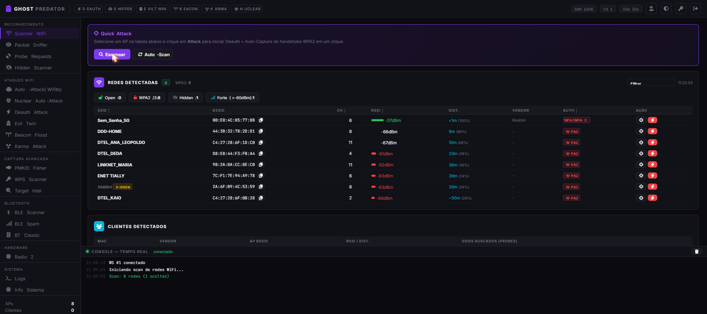
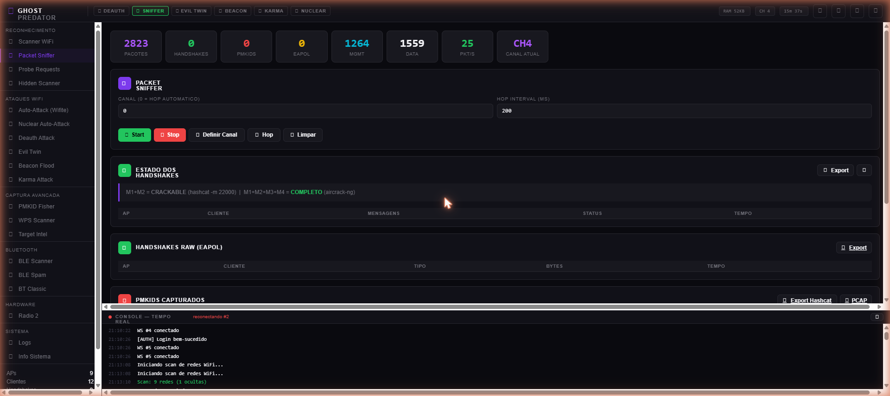
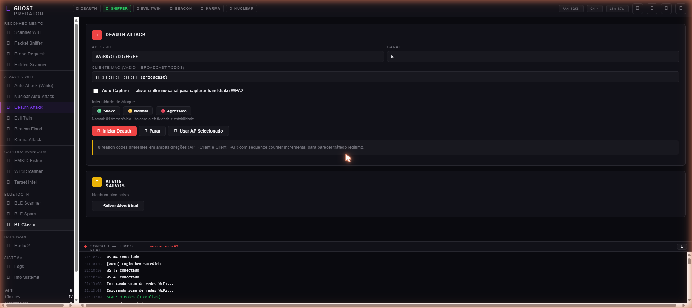
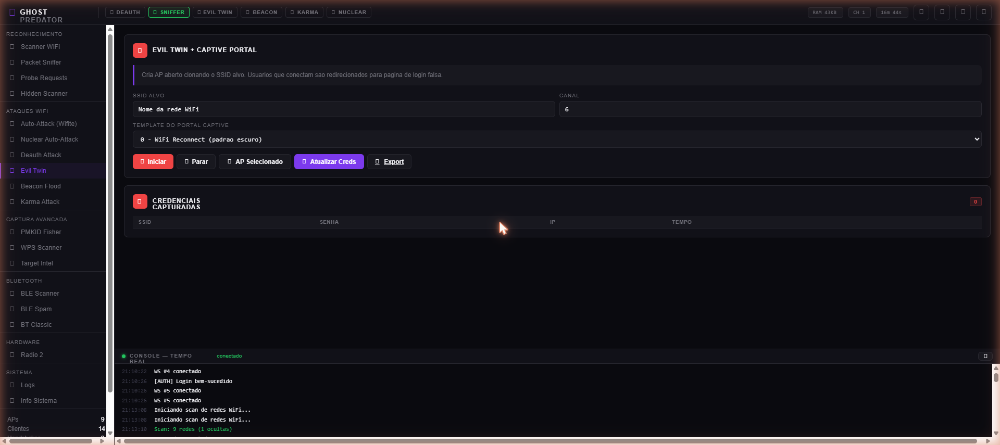
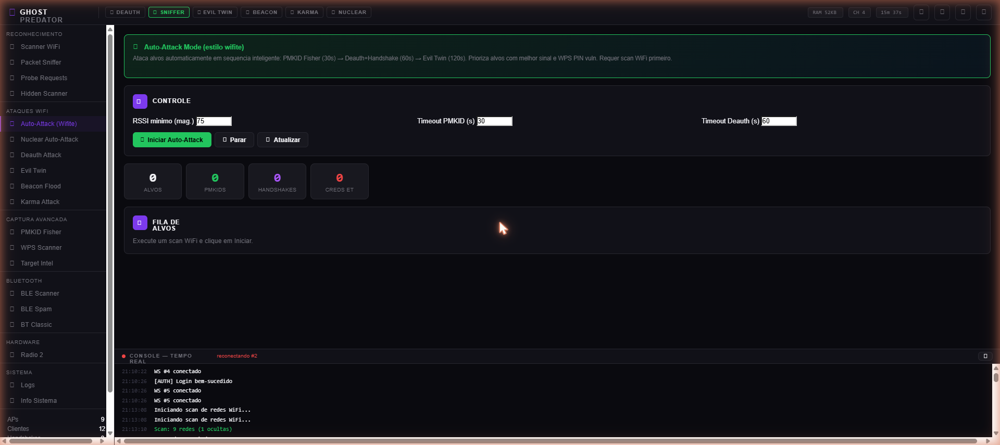
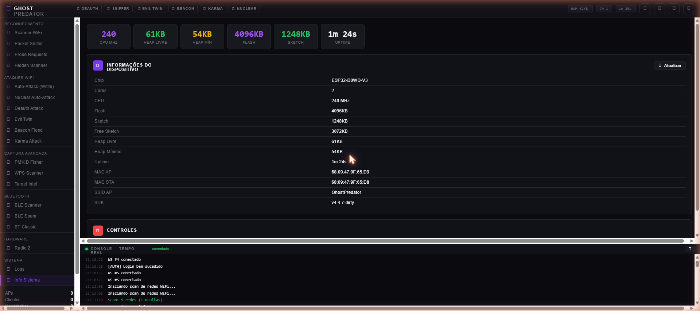

# Ghost Predator Mobile — ESP32

> Plataforma de avaliação de segurança WiFi/BLE portátil, rodando diretamente no ESP32 com interface web SPA acessível pelo celular ou notebook.

**Versão atual: v4.1**

---

## Visão Geral

O Ghost Predator Mobile transforma um ESP32 em uma ferramenta completa de auditoria wireless. Não requer computador, aplicativo ou sistema operacional especial — basta conectar ao AP `GhostPredator` e acessar `192.168.4.1` no navegador.

```
ESP32  ──►  AP GhostPredator (192.168.4.1)
                    │
              Navegador Web
           (mobile ou desktop)
```

---

## Screenshots

### Scanner WiFi


### Packet Sniffer


### Deauth Attack


### Evil Twin + Captive Portal


### Auto-Attack (Wifite Mode)


### Info Sistema


---

## Funcionalidades

### Reconhecimento
| Módulo | Descrição |
|--------|-----------|
| **Scanner WiFi** | Scan 802.11 com RSSI, distância estimada, vendor OUI, clientes associados, canal map |
| **Packet Sniffer** | Captura promíscua com channel hopping — detecta EAPOL, PMKID, probe requests, beacons |
| **Probe Requests** | Histórico de SSIDs buscados por cada dispositivo próximo |
| **Hidden Scanner** | Descobre SSIDs ocultos enviando probe requests dirigidos |
| **Target Intel** | Fingerprint de dispositivos conectados: MAC, vendor, DNS queries, credenciais HTTP |

### Ataques WiFi
| Módulo | Descrição |
|--------|-----------|
| **Deauth Attack** | Injeção de frames deauth/disassoc em 16 reason codes + null frame PM=1 + SA Query flood (PMF bypass) + auth flood. 512 frames/ciclo no modo agressivo |
| **Evil Twin** | Clona SSID alvo, cria AP aberto com portal captive para captura de credenciais (3 templates) |
| **Beacon Flood** | Broadcast em massa de SSIDs falsos para saturar listas WiFi |
| **Karma Attack** | Responde a qualquer probe request se passando pelo AP buscado |
| **Nuclear Auto-Attack** | Executa Sniffer + Deauth + PMKID Fisher + Karma em paralelo |
| **Auto-Attack (Wifite)** | Sequência automática: PMKID Fisher → Deauth+Handshake → Evil Twin por alvo |
| **LED Panel Attack** | Deauth e flood direcionados a controladores LED (protocolos CL/WLED) |

### Captura Avançada
| Módulo | Descrição |
|--------|-----------|
| **PMKID Fisher** | Captura PMKIDs via Auth+Assoc forçados sem precisar de cliente conectado |
| **WPS Scanner** | Detecta APs com WPS ativo, versão e vulnerabilidade PIN |
| **Packet Sniffer** | Export PCAP e hashcat para cracking offline |

### Bluetooth
| Módulo | Descrição |
|--------|-----------|
| **BLE Scanner** | Scan e enumeração de dispositivos BLE próximos |
| **BLE Spam** | Flood de advertisings BLE (Apple/Android/Samsung/Windows) |
| **BT Classic** | Detecção de dispositivos Bluetooth Classic |

---

## Hardware Suportado

| Chip | Board | Observação |
|------|-------|------------|
| ESP32-D0WD-V3 | DevKit v1 / WROOM-32 | Recomendado — testado |
| ESP32-S3 | DevKitC-1 | Suportado |
| ESP32-C3 | DevKitM-1 | Suportado (RISC-V) |

> **Antena**: recomenda-se antena externa para maior alcance.

---

## Instalação

### Pré-requisitos
- [Python 3.x](https://python.org)
- [PlatformIO](https://platformio.org): `pip install platformio`

### Passos

```bash
git clone https://github.com/Ghost-Bx1/Ghost-Raptor-Mobile-ESP32.git
cd Ghost-Raptor-Mobile-ESP32
```

**1. Compilar e fazer upload do firmware:**
```bash
pio run --target upload -e esp32dev
```

**2. Fazer upload do filesystem (interface web):**
```bash
pio run --target uploadfs -e esp32dev
```

> Substitua `esp32dev` por `esp32-s3` ou `esp32-c3` se necessário.

**Windows (script automático):**
```powershell
.\upload_fs.ps1
```

### Acesso

1. Conecte ao WiFi: **`GhostPredator`** / senha: **`predator123`**
2. Abra o navegador: **`http://192.168.4.1`**
3. Senha do painel: **`predator`**

---

## Interface Web

- **Topbar**: badges de ataque com animação pulse quando ativos (DEAUTH / SNIFFER / EVIL TWIN / BEACON / KARMA / NUCLEAR)
- **Sidebar**: 20 módulos organizados por categoria com contadores ao vivo
- **Console**: log em tempo real via WebSocket com reconexão automática
- **Quick Attack**: seleciona AP na tabela e dispara Deauth + captura em 1 clique
- **Tema**: suporte a claro/escuro com toggle

---

## Atalhos de Teclado

| Atalho | Ação |
|--------|------|
| `Alt+S` | Iniciar scan WiFi |
| `Alt+D` | Ir para Deauth |
| `Alt+E` | Ir para Evil Twin |
| `Alt+L` | Ir para Logs |
| `Ctrl+K` | Limpar console |

---

## Arquitetura

```
src/
├── main.cpp              # Setup, FreeRTOS tasks (core 0 / core 1)
├── config.h              # Constantes globais, credenciais AP
├── web/server.h          # ESPAsyncWebServer + todas as rotas /api/*
├── wifi/
│   ├── scanner.h         # Scan 802.11, OUI lookup
│   ├── sniffer.h         # Modo promíscuo, EAPOL/PMKID parser
│   ├── deauth.h          # Injeção raw 802.11 — deauth/disassoc/null/SA Query
│   ├── evil_twin.h       # AP clone + captive portal + DHCP/DNS
│   ├── beacon_flood.h    # Beacon spam
│   ├── karma.h           # MANA/Karma probe response
│   ├── pmkid_fisher.h    # PMKID capture
│   ├── wps_scanner.h     # WPS detection
│   ├── target_intel.h    # Device fingerprinting
│   ├── hidden_scanner.h  # Hidden SSID discovery
│   └── radio2.h          # Segundo rádio (UART2)
├── bluetooth/
│   ├── ble_scanner.h     # BLE scan + GATT enum
│   ├── ble_spam.h        # NimBLE advertising flood
│   └── bt_classic.h      # BT Classic detection
└── utils/logger.h        # Sistema de logs com níveis

data/
└── index.html            # SPA frontend (2800+ linhas, zero dependências externas)
```

---

## Técnicas de Deauth (v4.1+)

O módulo `deauth.h` implementa múltiplas camadas de ataque:

- **Deauth + Disassoc** em ambas direções (AP→Cliente e Cliente→AP)
- **16 reason codes** IEEE 802.11-2020 rotacionados por burst
- **Null Data Frame PM=1** — engana o AP para bufferizar tráfego do cliente (power-save trick)
- **SA Query Flood** — contorna proteção 802.11w/PMF
- **Auth Flood** — inunda a tabela de associação do AP com MACs aleatórios
- **Sequence counter incremental** — frames parecem tráfego legítimo
- **Multi-alvo por canal** — agrupa alvos por canal para minimizar trocas `esp_wifi_set_channel()`

| Modo | Frames/ciclo |
|------|-------------|
| Suave | 64 |
| Normal | 256 |
| Agressivo | 512 |

---

## Aviso Legal

Esta ferramenta destina-se **exclusivamente** a fins educacionais e testes de segurança em redes próprias ou com autorização explícita do responsável. O uso não autorizado em redes de terceiros é ilegal. Os autores não se responsabilizam por uso indevido.

---

## Licença

MIT — veja [LICENSE](LICENSE)
